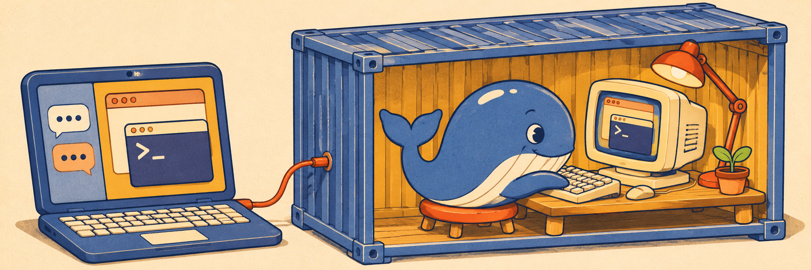
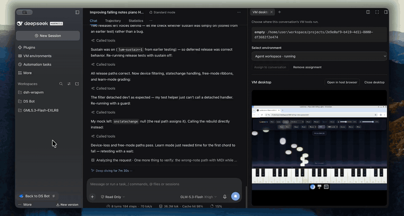

# DSH Isolated

[](https://github.com/Alexintosh/dsh-wrapvm/releases) [](https://www.npmjs.com/package/dsh-wrapvm-isolate) [](LICENSE) 

> A full Linux desktop for your DeepSeek Harness agent — inside Docker, away from your host.



Your agent needs a real environment to do useful work: a shell, Chrome, a desktop. Your host needs to stay untouched. DSH Isolated gives the agent both — a disposable Linux machine in a Docker container, with its screen visible right next to the chat.

**Run Harness in read-only mode on your host.** In this setup, host isolation comes only from the Harness sandbox — the container is a workspace for the agent, not a security boundary.
<p align="center">
   
</p>

## Why not just use Docker directly?

| | No isolation | Raw Docker + compose | DSH Isolated |
| --- | --- | --- | --- |
| Agent works directly on your host | Yes | No | No |
| Full Linux desktop + browser for the agent | — | Build it yourself | Included |
| Start/stop, CPU and memory limits from the chat | — | CLI only | Built in |
| Setup | None | Write compose files and image plumbing | Install plugin, send one prompt |

## Quick start

Requires [DeepSeek Harness 0.2.2-rc.5](https://github.com/deepseek-ai/deepseek-harness), Docker, and a Wrapvm desktop image (default tag `wrapvm-dsh:desktop`).

1. Fetch the plugin archive (keep it as a `.tgz`):

   ```bash
   npm pack dsh-wrapvm-isolate@0.3.2
   ```

   Or download the [tarball](https://www.npmjs.com/package/dsh-wrapvm-isolate) directly. A [SHA-256 checksum](dist/dsh-wrapvm-isolate-0.3.2.tgz.sha256) is available for verification.
2. In Harness: **Plugins → Add plugin**, pick the archive, enable **Wrapvm desktop**.
3. In a conversation, send:

   ```text
   Prepare a VM for this project. Use the guest shell to show the current
   directory and list the project files.
   ```

The agent starts a container, copies your project in, and selects it. Open **VM desktop** in the sidebar to watch it live.

## See it work

Ask the agent to make a change in the guest:

```text
In the guest workspace, create a file called vm-check.txt containing
"Hello from the VM". Export it so I can review it on my machine.
```

The file lands in your project's `.wrapvm-exports/review-*` directory. You decide what makes it back into the repo — nothing in the guest touches your host unless you export it or mount a folder read-write. Stopping the environment keeps the guest workspace in a named Docker volume; **VM environments** restarts it or adjusts CPU and memory.

## What gets shared

| | |
| --- | --- |
| **Project files** | Copy of eligible uncommitted and untracked files. Skips Git history, dependencies, credential files and symlinks. Limits: 5,000 files, 64 MiB total, 2 MiB per file. |
| **Host folders** | Optional bind mount for live access. Read-write mounts let the guest edit host files directly; Harness asks approval for the path and mode. |
| **Tools & network** | Guest tools run inside the container. Ordinary Harness tools keep their host permissions. The desktop backend needs internet; viewer links grant desktop access — keep them private. |

With Harness in read-only mode, those host permissions shrink to reading — the container gives the agent room to work, the sandbox keeps your host unchanged.

## Troubleshooting

| What you see | What to check |
| --- | --- |
| Docker is unavailable | Run `docker info` on the Harness host, start the engine, retry. |
| Desktop image missing | `docker image inspect wrapvm-dsh:desktop` (or your configured tag). |
| Project exceeds copy limit | Open a smaller project directory and prepare again. |
| Browser window doesn't open | Click **Open authenticated link** in the viewer, or use the embedded desktop. |

Full agent tools and configuration: [plugin reference](docs/PACKAGE.md) · Build and tests: [development guide](docs/DEVELOPMENT.md)

Built on [Wrapvm](https://github.com/tobi/wrapvm) and [DeepSeek Harness](https://github.com/deepseek-ai/deepseek-harness).
